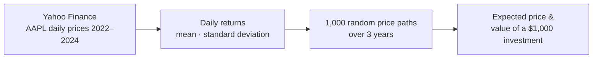
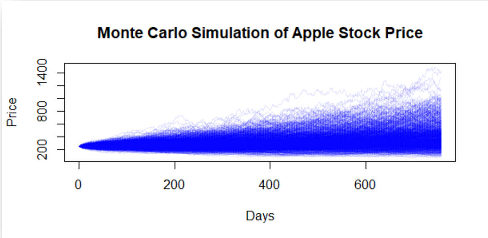

# 📈 Monte Carlo Simulation of Apple Stock

**What could $1,000 invested in Apple be worth in three years?**
Historical returns → 1,000 simulated price paths → expected value and range of outcomes.

`1,000 simulations` · `757 trading days (≈3 years)` · `AAPL 2022–2024 data`

> This repository is a **project showcase**. Source code and the full report are private.
> Contact: albinajeti20@gmail.com

## Overview

| Stage | What I did |
|---|---|
| **1. Data** | Downloaded Apple's daily prices from January 2022 to December 2024 with `quantmod`. I chose this period to leave out the COVID-19 shock. |
| **2. Parameters** | Calculated the mean and standard deviation of daily returns. |
| **3. Simulation** | Generated 1,000 random price paths over 757 trading days, drawing daily returns from a normal distribution. |
| **4. Result** | Averaged the final prices to get the expected price and the expected value of the investment. |

## Results

| | Value |
|---|---|
| Starting price | **$255.59** |
| Expected price after ~3 years | **$404.70** |
| $1,000 invested becomes | **$1,583.40** (+58.3%) |

The paths spread out widely over time, so the simulation shows both the expected gain and the risk around it.

## Limitations
- Assumes future returns behave like 2022–2024 (constant mean and volatility)
- Ignores external shocks such as crises or company news
- Next: add percentile bands (e.g. 5%–95%) and compare with models such as GARCH

© 2025 Albin Ajeti. All rights reserved. See [LICENSE](LICENSE).
